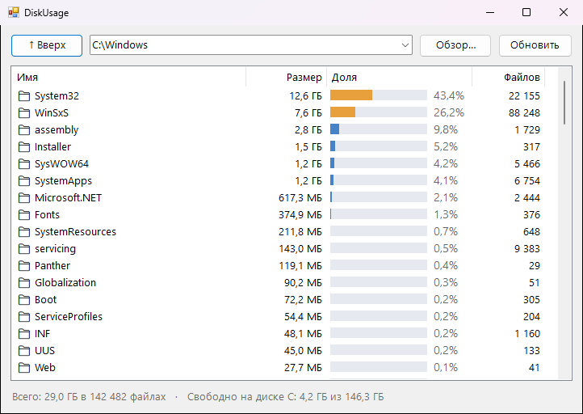

<div align="center">

# 💽 DiskUsage

**Показывает, какие папки съели место на диске, с процентами и полосками**




</div>

## ✨ Возможности

- 📊 Размер каждой папки и файла с долей в процентах и цветной полоской: крупное видно сразу
- 🔽 Двойной клик заходит внутрь, `Backspace` или «Вверх» возвращают назад
- ⚡ Список появляется сразу, размеры досчитываются в фоне. Уже посчитанные папки запоминаются
- 💾 Свободное место на диске в строке состояния
- 📂 Правый клик открывает папку в Проводнике. Папку можно передать в аргументах: `DiskUsage.exe "D:\"`
- 🔒 Только смотрит и ничего не удаляет

## 💡 Когда пригодится

- Диск C: внезапно забился, а непонятно чем
- Ищешь забытые игры, старые бэкапы и кэши на гигабайты
- Решаешь, что перенести на другой диск

## 📥 Установка

1. Скачай `DiskUsage.exe` из раздела [**Releases**](../../releases/latest)
2. Запусти его, установка не нужна

## 🛠️ Сборка из исходников

Нужен только Windows: компилятор C# входит в состав .NET Framework.

```bat
build.bat
```

## 📄 Лицензия

[MIT](LICENSE)
